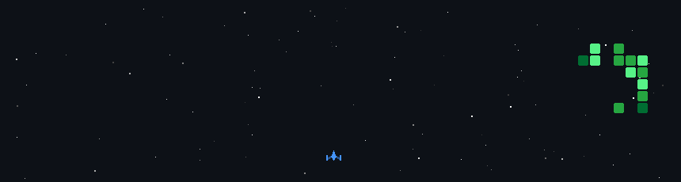

<p align="center">
  
</p>

<p align="center">
  Front-end developer building with <b>React</b>, <b>Next.js</b>, <b>NestJS</b> and <b>TypeScript</b>.<br>
  Studying Computing and working my way toward <b>cybersecurity</b>.
</p>

## 👾 About me

```ts
const dima = {
  role: "Front-end developer",
  stack: {
    frontend: ["React", "Next.js", "TypeScript"],
    backend: ["NestJS", "Node.js"],
    deploy: "the basics, learning more",
  },
  education: [
    "Front-end development course (completed 2024)",
    "Computing: NextGen HNC @ New College Lanarkshire (in progress)",
  ],
  currentlyBuilding: "World of Agents",
  nextQuest: "cybersecurity",
} as const;
```

## 🛠️ Tech stack

<p align="center">
  
</p>

## 🚀 Featured projects

<table>
  <tr>
    <td width="50%" valign="top">
      <h3><a href="https://github.com/kremendev/world-of-agents">🏰 World of Agents</a></h3>
      <p>A pixel-art office in a fantasy guild hall. Five AI agents (Lead/PM, Designer, Frontend dev, Backend dev, Reviewer) sit at their desks and visibly work on the task you give them.</p>
      <p><code>React 19</code> <code>TypeScript</code> <code>Vite</code> <code>Canvas 2D</code> <code>Zod</code></p>
    </td>
    <td width="50%" valign="top">
      <h3><a href="https://github.com/kremendev/good-prompt-reminder">🧠 good-prompt-reminder</a></h3>
      <p>A Claude skill that turns a rough request into a clear prompt: goal, context, action and output format. It marks every part as stated, guessed or missing before any work starts.</p>
      <p><code>Claude Skills</code> <code>Prompt design</code></p>
    </td>
  </tr>
  <tr>
    <td colspan="2" valign="top">
      <h3>📷 Pinhole Photography</h3>
      <p>A responsive one-page site for a photography agency, built for a college web dev challenge. Same brief, built twice: <a href="https://github.com/kremendev/pinhole-manual">hand-coded</a> and <a href="https://github.com/kremendev/pinhole-ai">AI-assisted</a>.</p>
      <p><code>HTML</code> <code>CSS</code> <code>JavaScript</code></p>
    </td>
  </tr>
</table>

<!-- analyser:start -->
<!-- analyser:end -->

## 🛰️ Side quests

| | |
| --- | --- |
| 🤖 **AI & agents** | how AI agents can split up work, build and review each other |
| 🦾 **Robotics** | machines that move and act in the real world |
| 🌌 **Space & spaceships** | spaceflight, rockets and everything beyond the atmosphere |
| 🎮 **Video games** | playing them, and borrowing their ideas for UI |
| 📰 **New tech** | keeping up with tech news and trying new tools early |

## 🗺️ Quest log

- [x] Front-end development course
- [ ] Computing: NextGen HNC
- [ ] World of Agents v1: scripted demo
- [ ] World of Agents v2: real agents
- [ ] Cybersecurity 🔐

## 🎯 My contributions, space shooter edition

<p align="center">
  
</p>

<p align="center"><sub>Regenerated daily by a GitHub Action from my contribution graph, using <a href="https://github.com/czl9707/gh-space-shooter">gh-space-shooter</a>.</sub></p>
